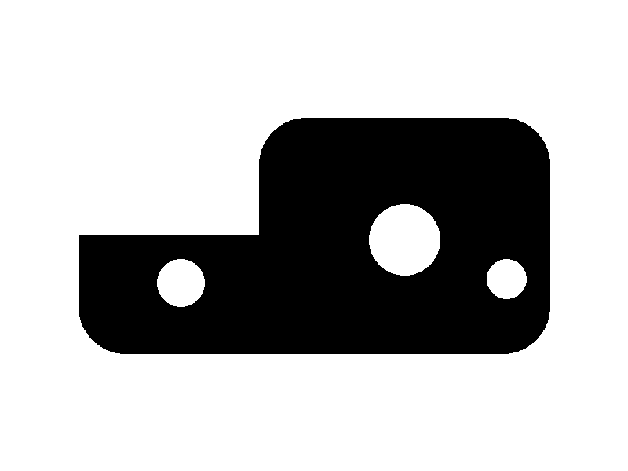
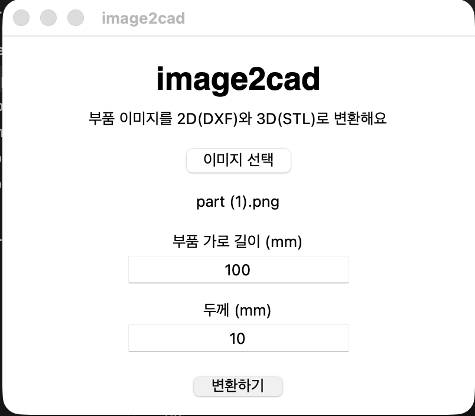
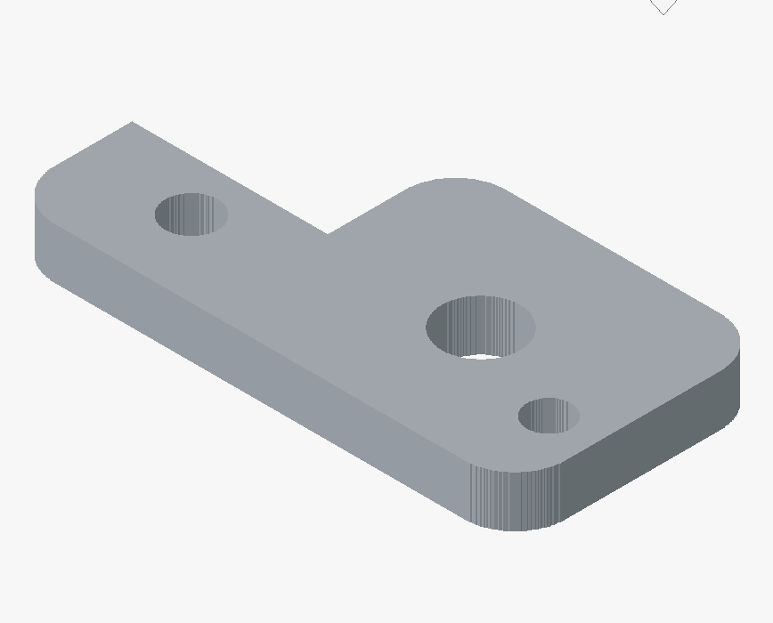

# image2cad

부품 이미지를 올리면 2D 도면(DXF)과 3D 모델(STL)로 변환해주는 프로그램

## 만든 이유
부품 3D 모델링 업무를 하면서, 이미지나 스케치를 보고 CAD로 옮겨 그리는 과정이 번거롭다고 느꼈습니다. 이미지만 넣으면 2D 도면과 3D 모델의 초안이 바로 나오는 프로그램을 직접 만들어보고 싶었습니다.

## 기능
- 흰 배경에 검은 부품 이미지에서 외곽선과 구멍을 자동 인식
- 실제 가로 길이(mm)를 입력하면 실제 크기로 변환
- 두께(mm)를 입력하면 3D 모델로 돌출
- DXF(2D 도면)와 STL(3D 프린팅용) 파일로 저장

## 사용 기술
Python, OpenCV(윤곽선 인식), ezdxf(DXF 생성), trimesh·shapely(3D 모델 생성), tkinter(화면)

## 실행 방법
```
pip install opencv-python ezdxf numpy trimesh shapely mapbox-earcut
python app.py
```
1. 이미지 선택
2. 가로 길이와 두께 입력
3. 변환하기 → 저장할 폴더 선택

## 결과 예시

| 입력 이미지 | 프로그램 화면 | 3D 결과 (FreeCAD) |
|---|---|---|
|  |  |  |

입력 100mm × 두께 10mm 기준으로 3D 크기 100.0 × 50.0 × 10.0mm가 나옴을 확인했습니다.

## 한계와 개선 계획
- 현재는 흰 배경에 검은 단색 부품 이미지만 지원
- 곡선은 점으로 근사하기 때문에 거칠게 나올 수 있음
- 곡선을 더 부드럽게 처리하고, STEP 파일로도 저장할 수 있게 하고 싶습니다. 손으로 그린 스케치나 도면 이미지도 인식하도록 확장해보고 싶습니다.

## 개발 과정
AI(Claude)의 도움을 받아 개발했습니다. 만들고 싶은 기능과 결과물(이미지 → 2D·3D)은 직접 정했고, 개발 환경(Python, VS Code)을 설치하고 코드를 실행하며 에러를 해결했습니다. 완성된 STL은 FreeCAD에서 열어 3D 크기와 구멍 위치가 이미지와 맞는지 직접 확인했습니다.